# Fabric AI Ready Data Day2 ハンズオン手順（Foundry IQ 版）

## 目次

- [Fabric AI Ready Data Day2 ハンズオン手順（Foundry IQ 版）](#fabric-ai-ready-data-day2-ハンズオン手順foundry-iq-版)
  - [目次](#目次)
  - [Day2 のゴール](#day2-のゴール)
  - [構成と検証の流れ](#構成と検証の流れ)
  - [事前確認](#事前確認)
    - [データ、アカウント、ライセンス](#データアカウントライセンス)
    - [運営が事前に確認する接続と権限](#運営が事前に確認する接続と権限)
  - [Foundry リソースとモデルを準備する](#foundry-リソースとモデルを準備する)
  - [AI Search を作成して接続する](#ai-search-を作成して接続する)
    - [ナレッジ画面からリソースを作成する](#ナレッジ画面からリソースを作成する)
    - [権限を付与する](#権限を付与する)
  - [SharePoint の実験用文書を準備する](#sharepoint-の実験用文書を準備する)
  - [IQ に SharePoint を接続する](#iq-に-sharepoint-を接続する)
    - [SharePoint Remote とナレッジベースの作成](#sharepoint-remote-とナレッジベースの作成)
    - [Agent への接続と OBO の事前確認](#agent-への接続と-obo-の事前確認)
  - [SharePoint のサイト権限切り替えを検証する](#sharepoint-のサイト権限切り替えを検証する)
    - [共通条件と Prompt A](#共通条件と-prompt-a)
    - [テスト A：サイト 1 の V1 から 8% を取得する](#テスト-aサイト-1-の-v1-から-8-を取得する)
    - [テスト B：サイト 1 からサイト 2 へ権限を切り替え、12% を取得する](#テスト-bサイト-1-からサイト-2-へ権限を切り替え12-を取得する)
  - [Fabric Ontology を IQ に追加する](#fabric-ontology-を-iq-に追加する)
    - [Ontology のナレッジ ソース](#ontology-のナレッジ-ソース)
  - [Fabric と SharePoint の統合回答を確認する](#fabric-と-sharepoint-の統合回答を確認する)
  - [IQ に Web 検索を追加する](#iq-に-web-検索を追加する)
    - [Web Knowledge Source の追加](#web-knowledge-source-の追加)
    - [Fabric、SharePoint、Web の統合テスト](#fabricsharepointweb-の統合テスト)
  - [Teams に公開して動作確認する](#teams-に公開して動作確認する)
    - [公開操作](#公開操作)
  - [トラブルシューティング](#トラブルシューティング)
    - [問題の切り分け](#問題の切り分け)
  - [参考資料](#参考資料)

## Day2 のゴール

- SharePoint（Remote）を Foundry IQ の最初のナレッジ ソースにし、2 つのテストサイト間で読み取り権限を切り替えたときの結果を比較する。
- Day1 の Ontology を同じ IQ ナレッジ ベースに追加し、業務データの年度集計と都市別集計を検証する。
- SharePoint、Ontology、Web の順にナレッジ ソースを段階的に検証し、3 種類の情報を統一した経路から取得する。
- IQ に Web Knowledge Source を追加し、業務データ・社内文書・公開情報を組み合わせて回答する。
- 運営が公開後の認証を事前検証した環境では、Teams でも動作確認する。

> 本手順にはプレビュー機能が含まれる。対象テナント・リージョン・ポータルの対応状況を事前に確認する。画面名は日本語／英語や更新時期によって異なる。既存画像は操作位置の参考とし、IQ 固有の設定値と検証条件は本文に従う。

## 構成と検証の流れ

```text
利用者の Microsoft Entra ID
  |
Foundry Agent（gpt-5.6-luna）
  `-- Foundry IQ ナレッジ ベース Tool（MCP）
        |-- SharePoint（Remote）：営業改善施策ガイド
        |-- Fabric Ontology：Day1 の業務エンティティ、関係、データバインディング
        `-- Web Knowledge Source：Bing による公開情報検索（後半で追加）
```

- 主経路は IQ ナレッジ ベースの 1 接続に統一する。Fabric の数値も **Fabric Ontology ナレッジ ソース**から取得し、Agent に独立した Fabric Data Agent Tool は接続しない。
- Ontology ナレッジ ソースは検索時に Fabric を問い合わせる Remote のナレッジ ソースである。OneLake 文書の Indexed 検索や、Ontology を Data Agent に追加する操作とは異なる。
- Day1 の Fabric Data Agent は削除せず、セマンティックモデルの集計と比較する経路として保持する。代替として使用する場合は後述の手順で明示し、Ontology の成功として扱わない。
- Foundry IQ は Azure AI Search を基盤とするナレッジ ベース機能である。「Foundry IQ」という別の Azure リソースを作成する操作ではない。
- SharePoint は **Remote** を選択する。文書を取り込む **Indexed** は使用せず、この実験用の文書インデックス、インデクサー、埋め込みモデルは作成しない。
- Remote は検索時に Copilot Retrieval API を呼び出す。Microsoft 365 側の検索基盤は利用するため、「保存後、必ず即時に反映する」という保証ではない。
- 既存 Agent の独立した **Fabric Data Agent**、**Web search**、**SharePoint** ツールは主経路で併用しない。

| 順序          | 検証                                                         | IQ ナレッジ ベースが参照するナレッジ ソース |
| ------------- | ------------------------------------------------------------ | ------------------------------------------- |
| SharePoint 1  | サイト 1 の V1 文書を取得し、結果 A を確認                   | SharePoint Remote のみ                      |
| SharePoint 2  | サイト 1 の権限を削除し、サイト 2 の V2 文書へ権限を付与する | SharePoint Remote のみ                      |
| Ontology 統合 | Employee の Profit 変化をサイト 2 のガイドで判定             | Fabric Ontology + SharePoint Remote         |
| Web 統合      | 売上上位都市、人口動向、社内ガイドを組み合わせる             | Fabric Ontology + SharePoint Remote + Web   |

同じナレッジ ベース `aidata-kb-＜No＞` にナレッジ ソースを順番に追加する。最初に SharePoint Remote だけで検証し、その構成を残したまま Ontology を追加する。最後に Web を追加し、ナレッジ ソースを減らしたり参照から外したりしない。各テストは新しい会話で行い、メモリ ストアは接続しない。

## 事前確認

### データ、アカウント、ライセンス

1. [Day1](day1-hands-on-fabric.md) を完了し、次の実リソース名と URL を確認する。

   - ワークスペース: `aidataws＜No＞`
   - セマンティックモデル: `aidatasemantic＜No＞`
   - 主経路の Ontology: `aidataontology＜No＞`。ワークスペース ID、Ontology 項目 ID、データバインディングを確認済みであること。
   - 比較・代替用の公開済み Fabric Data Agent: `aidatadataagent＜No＞`
   - Day1 で確認したセマンティックモデルの基準値: 2013／2014 年の Employee 別 Profit、差額・増減率、2016 年の City 別売上
   - [共通の命名規則](README.md#命名規則)に従う。既存環境で異なる名前を使用している場合は、リソースを改名・再作成せず、実際の名前と ID を対応付けて使用する。
2. Azure AI Search、Fabric workspace、SharePoint は同じ Microsoft Entra テナントを使用する。Ontology のテナント設定と対象環境の対応状況を確認する。
3. SharePoint を検索する各ユーザーに、Microsoft 365 Copilot ライセンス、または Retrieval API の従量課金設定があることを確認する。従量課金の有効化は管理者が事前に行う。現行の前提条件では、そのテナントに少なくとも 1 つの Microsoft 365 Copilot ライセンスも必要となる。
4. ユーザー が Foundry プロジェクト、Ontology と必要な参照元データを利用できることを確認する。比較用 Data Agent の利用権限も確認する。SharePoint 文書権限の変更中は、これらの権限を変更しない。
5. 本ラボでは Day1 のサンプルデータと架空のガイドだけを使用し、実際の機密文書や個人情報は使用しない。

### 運営が事前に確認する接続と権限

- Foundry リソースに紐づくプロジェクトを使用する。IQ 接続では Hub ベースのプロジェクトを使用しない。
- Agent と IQ のクエリ計画・Web 結果の要約には、**同じ `gpt-5.6-luna` デプロイ**を使用する。各 Foundry リソースで 1 デプロイ、**80,000 TPM** を手動設定し、IQ 用の別モデルを追加デプロイしない。
- 運営は同一サブスクリプション・リージョン・モデル・デプロイ種類の残り TPM と、参加者分の必要量を確認する。別リソースに分けてもサブスクリプションの共通クォータは増えない。既存デプロイの割り当ても含めて調整する。
- Azure AI Search は、後述の Foundry ポータルの **新しいリソースの作成** から **Serverless** で作成する。事前作成は必須ではない。運営は作成権限、Japan East など Serverless と agentic retrieval の両方に対応するリージョン、モデル接続・マネージド ID・OBO の動作を事前に確認する。Serverless のプレビュー条件を確認し、作成可能なことだけで全経路の検証済みとはしない。
- 設定担当者にはナレッジ ソースを管理する `Search Service Contributor`、必要なナレッジ ベースの読み取り権限、Foundry の接続作成権限を付与する。ロール割り当て自体は、その権限を持つ管理者が行う。
- Foundry プロジェクトのマネージド ID（Project Identity）から Search への接続権限は、AI Search 作成後に Azure portal で付与する。付与するロールは Search サービスのスコープの `Search Index Data Reader` である。手順は後述の「認証、接続、作成後の権限を確認する」に従う。ユーザー A や講師のユーザー アカウントには割り当てない。
- IQ がモデルを呼び出せるよう、AI Search のシステム割り当てマネージド ID を有効にし、対象 Foundry リソースでその ID に `Foundry User` を付与する。手順は後述の「認証、接続、作成後の権限を確認する」に従う。
- **サービス間認証とユーザー ID 透過は別に設定する。** プロジェクトのマネージド ID で Search に接続できても、Fabric や SharePoint にユーザー A の権限が適用されることの証明にはならない。
- IQ の MCP 接続では、リクエストごとにユーザー本人のトークンを `x-ms-query-source-authorization` で渡すユーザー ID 透過／OBO の経路を準備する。Ontology の場合は Search 用のスコープ `https://search.azure.com/.default` のユーザートークンを渡し、検索エンジンが Fabric 向けに交換する。サービス認証とは別のトークンであり、共有の管理者トークンを使用しない。SharePoint も公式手順に従って同じ利用者の ID が伝わることを検証する。
- [公式の IQ 接続手順](https://learn.microsoft.com/azure/foundry/agents/how-to/foundry-iq-connect)の「Enforce permissions with per-request headers」を確認する。ポータルで必要なユーザー ID 透過を構成できない環境では、運営が公式 SDK／REST フローを事前に準備し、同じテストを実行できる呼び出し画面を案内する。接続できたという理由だけで OBO を検証済みにしない。
- トークンを質問文、共有メモ、スクリーンショットに貼らない。アクセスログを記録する場合も認証情報を除去する。

Search 作成前には必要な権限と設定方針を確認し、作成後に対象リソースへ ID・RBAC・モデル接続の設定を適用する。自動で設定された項目も確認し、作成直後からすべての権限が設定済みとは仮定しない。

> Teams は追加の確認対象である。Playground の成功だけで、Teams 経由でも同じユーザー ID が伝わるとは判断しない。

## Foundry リソースとモデルを準備する

1. [Azure portal](https://portal.azure.com) で **Microsoft Foundry** を検索し、リソースを作成する。運営指定の既存リソースがあれば再利用する。

   - リソース グループ: Day1 の `rg-aidatahandson＜No＞` または運営指定の既存リソース グループ
   - リソース名: `foundry-aidata-＜unique＞`
   - リージョン: 必要なモデルと接続機能が利用できる運営指定リージョン
2. Foundry リソース配下のプロジェクトを作成または選択し、[Foundry ポータル](https://ai.azure.com) を開く。

   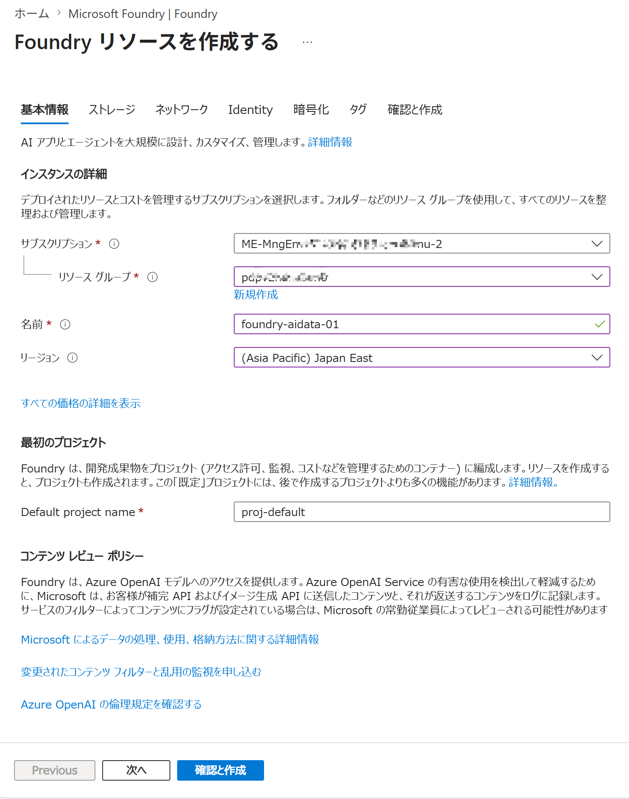
3. **ビルド / Build** → **モデル / Models** で `gpt-5.6-luna` を検索し、デプロイ画面を開く。モデル選択画面の参考は次のとおりである。

   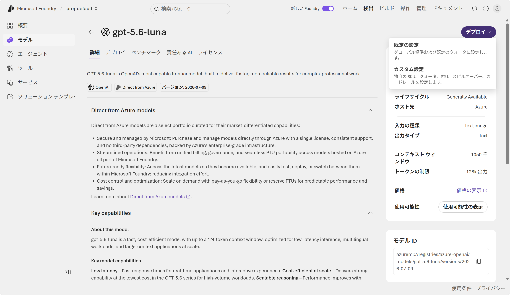
4. **カスタム設定**を選択する。編集画面で次を入力し、トークン数レート制限を確認してから **デプロイ** を選択する。

   | 設定                            | 値                                         |
   | ------------------------------- | ------------------------------------------ |
   | デプロイ名                      | `gpt-5.6-luna`                           |
   | デプロイの種類                  | **グローバル標準 / Global Standard** |
   | 1分あたりのトークン数レート制限 | **80000（80,000 TPM）**              |

   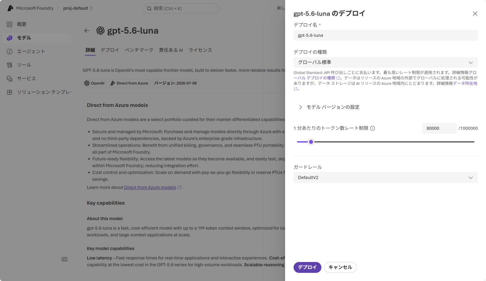

## AI Search（Foundry IQ） を作成して接続する

### ナレッジ画面からリソースを作成する

1. [Foundry ポータル](https://ai.azure.com) で対象プロジェクトを選び、**新しい Foundry** が有効であることを確認する。
2. 上部の **ビルド** → 左メニューの **ナレッジ** → **ナレッジ ベース** を開く。
3. 未接続の場合、画面下部に **Foundry IQ リソース**、**認証の種類**、**接続する** が表示される。リソース選択欄の下にある **新しいリソースの作成** を選択する。

   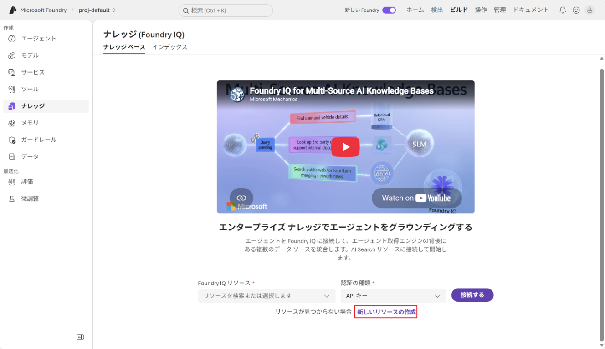
4. **Foundry IQ リソースを作成する** 画面で、次のとおり設定する。画面の更新により項目名や配置が異なる場合は、設定の意味と実際の作成先を確認する。

   | 項目                 | 設定                                                                                            |
   | -------------------- | ----------------------------------------------------------------------------------------------- |
   | サブスクリプション   | Day1 と同じ、または運営指定                                                                     |
   | リソース グループ    | `rg-aidatahandson＜No＞`                                                                      |
   | AI Search リソース名 | `srch-aidata-＜unique＞`                                                                      |
   | リージョン           | **Japan East**、または Serverless と agentic retrieval の両方に対応する運営指定リージョン |
   | 価格レベル           | **Serverless**                                                                            |

   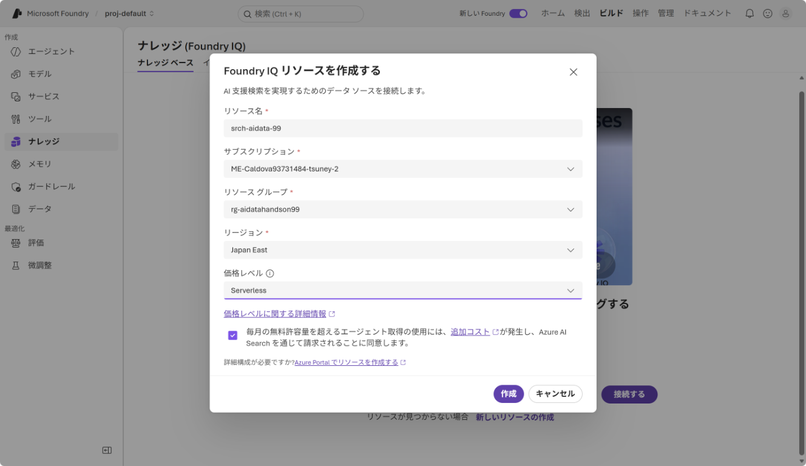

   画像の `srch-aidata-99` と `rg-aidatahandson99` は例である。サブスクリプション、参加者番号、一意な接尾辞は自身の実値に置き換え、画像内のサブスクリプション名はコピーしない。
5. 画面下部の追加コストと課金に関する説明を確認し、同意欄を選択し、**作成** を実行して完了を待つ。

### 権限を付与する

1. AI Search の作成が完了するまで待つ。Foundry のナレッジ画面に `srch-aidata-＜unique＞` が表示されることを確認する。
2. [Azure portal](https://portal.azure.com) を開き、作成した AI Search リソース `srch-aidata-＜unique＞` を開く。
3. 左メニューの **アクセス制御 (IAM)** を開き、**追加** → **ロールの割り当ての追加** を選択する。
   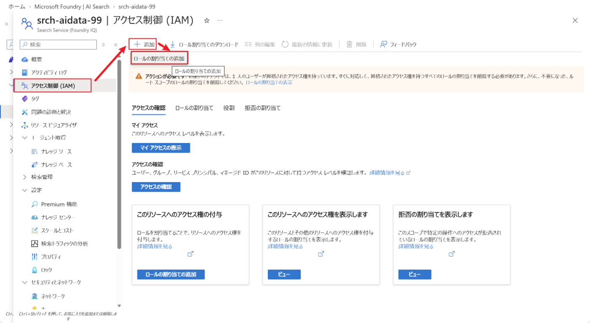
4. ロールに **検索インデックス データ閲覧者　(Search Index Data Reader)** を選択し、次へ進む。
   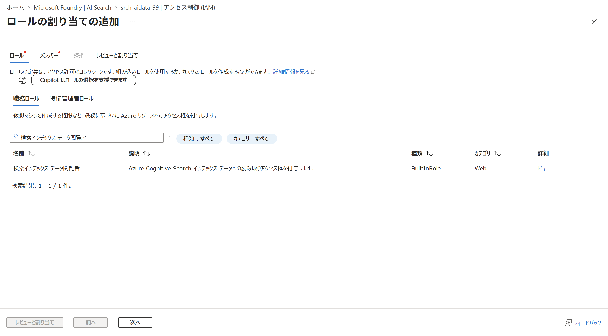
5. メンバーの割り当て先は **マネージド ID** とする。対象 Foundry プロジェクトの **Project Identity**（プロジェクトのシステム割り当てマネージド ID）を選択する。
   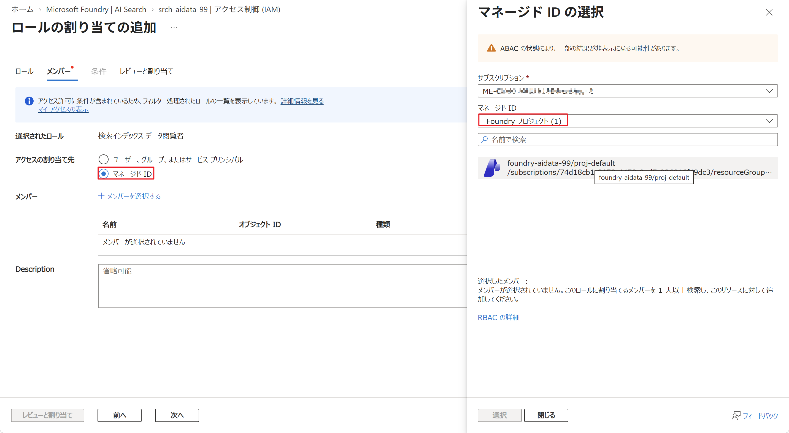
6. **レビューと割り当て**を選択して、IAM のロール割り当て一覧に、Project Identity へ **検索インデックス データ閲覧者　(Search Index Data Reader)** が付与されていることを確認する。
7. 同じ AI Search リソースで **セキュリティとネットワーク** → **ID** を開き、**システム割り当て済み / System assigned** を **オン** にして保存する。状態がオンになり、オブジェクト ID が表示されることを確認する。
8. 対象の Foundry リソース `foundry-aidata-＜unique＞` を開き、**アクセス制御 (IAM)** で **ロールの割り当ての追加** を選択する。
9. ロールに **Foundry User** を選択する。メンバーは **マネージド ID** とし、直前に有効化した AI Search のシステム割り当てマネージド ID を選択する。
   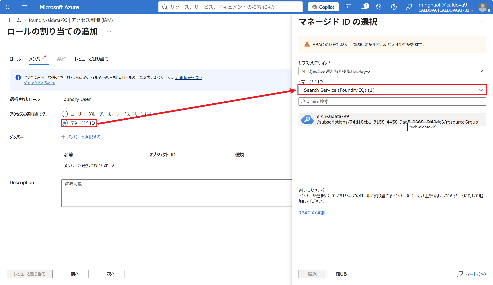
10. **レビューと割り当て**を選択して、Foundry リソースのロール割り当て一覧に、AI Search のシステム割り当て ID へ **Foundry User** が付与されていることを確認する。

## SharePoint の実験用文書を準備する

1. 講師は admin アカウントで、参加者ごとに独立した 2 つの SharePoint テストサイト（以降、**サイト 1** と **サイト 2**）を用意する。既存の業務サイトは使用しない。
2. サイト 1 の文書ライブラリに、配布ファイル [V1 の営業改善施策ガイド.docx](data/sharepoint/v1/営業改善施策ガイド.docx) をアップロードする。手動で作成する場合は **営業改善施策ガイド.docx** という名前で、本文へ次の V1 を入力する。配布ファイルも表や画像ではなく、通常のテキスト段落で構成している。

   ```text
   営業改善施策ガイド
   文書ID：HOL-SP-RAG-2016-01
   版：1.0

   本資料はハンズオン用の架空の営業ルールである。

   前年の年間Profitが正の値で、今年の年間Profitが前年比で8%以上減少した担当者を、
   営業改善レビューの対象とする。
   対象となった場合、2営業日以内に上長へ報告する。
   前年のProfitが0以下の場合は、この基準を機械的に適用せず個別確認する。

   レビューでは、売上数量、値引きの状況、販売商品の構成を確認する。
   Profitの減少だけを根拠に、原因を断定してはならない。

   重点都市の営業施策は、既存売上、収益性、公開されている人口動向を合わせて検討する。
   人口増加だけを根拠に、将来の売上増加を断定してはならない。

   確認コード：SP-A731
   ```
3. サイト 2 の文書ライブラリに、配布ファイル [V2 の営業改善施策ガイド.docx](data/sharepoint/v2/営業改善施策ガイド.docx) をアップロードする。V1 と同じファイル名および文書 ID を維持し、本文の期待値が **12%以上、1営業日以内、版 2.0、確認コード SP-B946** であることを確認する。
4. 両サイトで保存し、必要な場合はチェックイン、発行、承認を完了する。共有リンクではない実際のサイト URL とファイル URL をそれぞれ記録する。
5. 講師は admin アカウントでサイト 1 とサイト 2 の **アクセス許可の管理 / Manage access** を開き、講師側の管理権限を残したまま、初期状態では参加者ユーザーに **サイト 1 の読み取り権限だけ**を付与する。

> 確認コードは、新しい本文を取得したことを判別するための架空の文字列であり、秘密情報ではない。講師が別の値に変更する場合は、期待値にも記録する。ただし後述の Prompt A には値を書き込まない。
>
> V1 と V2 は同時に存在するが、異なるテストサイトに配置する。ユーザー A が両方を同時に読める状態を作らず、各テスト時点でアクセス可能なサイトを 1 つだけにする。

## IQ に SharePoint を接続する

### SharePoint Remote とナレッジベースの作成

1. Foundry プロジェクトの **ビルド / Build** → **ナレッジ / Knowledge** を開く。
2. 「Foundry ポータルから AI Search を作成して接続する」で接続した `srch-aidata-＜unique＞` を使用していることを確認し、**ナレッジベースの作成**を選択する。
   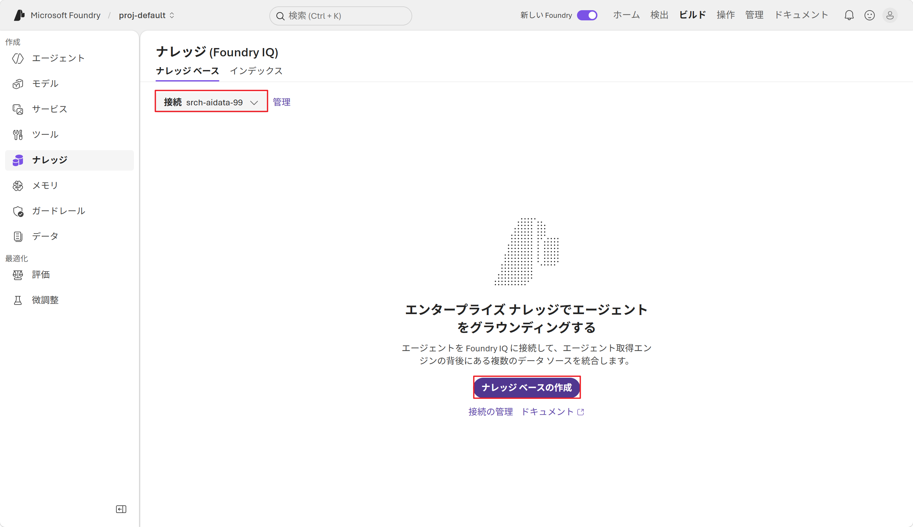
3. **新しいナレッジベースの作成** 画面では、先に **基本構成** を入力する。この時点ではナレッジ ソースを追加しない。

   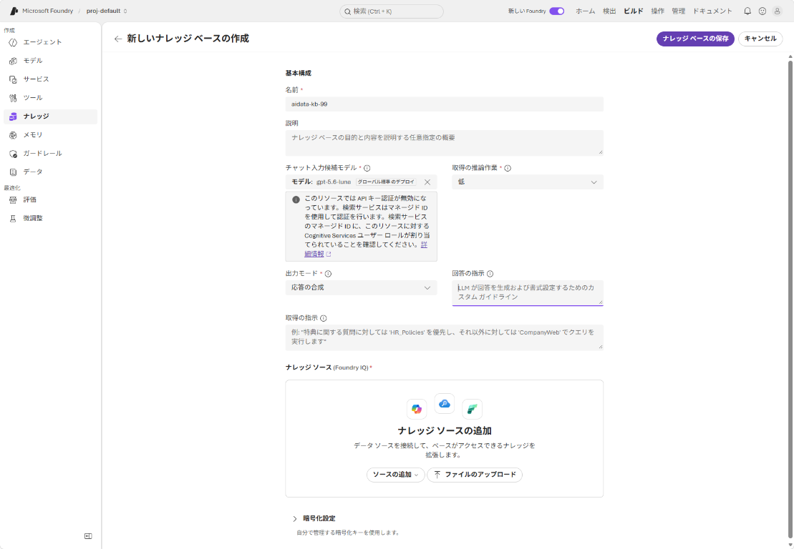

   | 設定                   | 値                                                                                                                  |
   | ---------------------- | ------------------------------------------------------------------------------------------------------------------- |
   | 名前                   | `aidata-kb-＜No＞`                                                                                                |
   | 説明                   | この参加者の SharePoint 文書を検索するナレッジ ベース。後続で Ontology と Web を追加する                            |
   | チャット入力候補モデル | 「Foundry リソースとモデルを準備する」で作成した**同じ `gpt-5.6-luna` デプロイ**。IQ 用に追加デプロイしない |
   | 取得の推論作業         | **低**。画面の値は low                                                                                        |
   | 出力モード             | **応答の合成**                                                                                                |
   | 回答の指示             | 取得した内容だけを根拠に回答する。取得できない項目は推測しない                                                      |
   | 取得の指示             | 指定された文書 ID の本文を検索し、参照元と版を返す。情報がない場合は推測しない                                      |
4. 基本構成の下にある **ナレッジソース（Foundry IQ）** で **ソースの追加** → **さらにご参照** を選択し、ナレッジ ソースの種類に **SharePoint（Remote）** を選択し、**接続**を選択する
   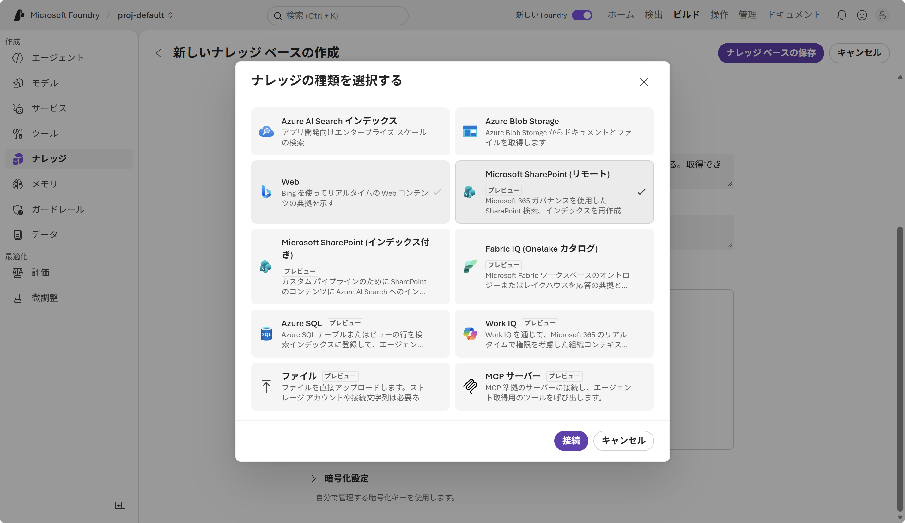
5. 次を設定し、**作成**を選択する。

   | 設定 | 値                          |
   | ---- | --------------------------- |
   | 名前 | `aidata-sp-remote-＜No＞` |


   > 検索範囲を制限したい場合は、 [SharePoint Remote の公式手順](https://learn.microsoft.com/azure/search/agentic-knowledge-source-how-to-sharepoint-remote)をご参照してください。
   > 　　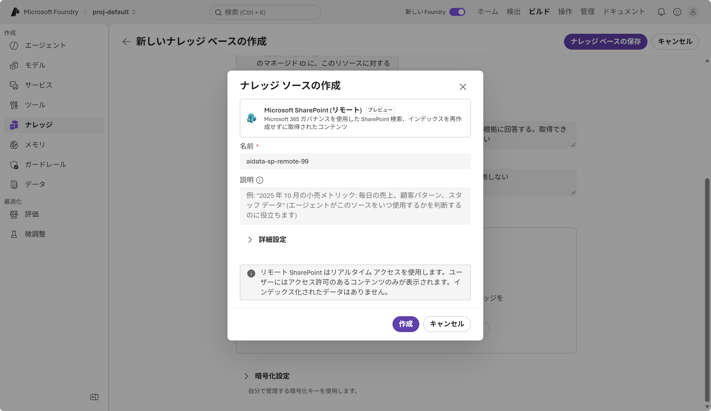
   >
6. ナレッジ ソースの追加が完了したことを確認し、画面右上の **ナレッジベースの保存** を選択する。
   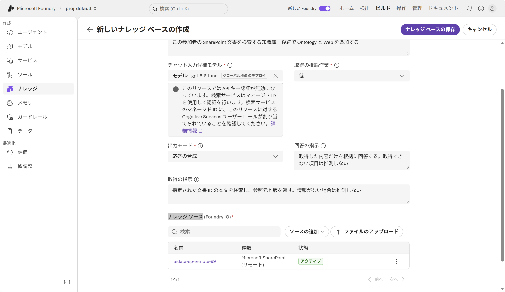

### Agent への接続と OBO の事前確認

1. Foundry の **エージェント / Agents** で `aidata-agent-app＜No＞` を作成する。
   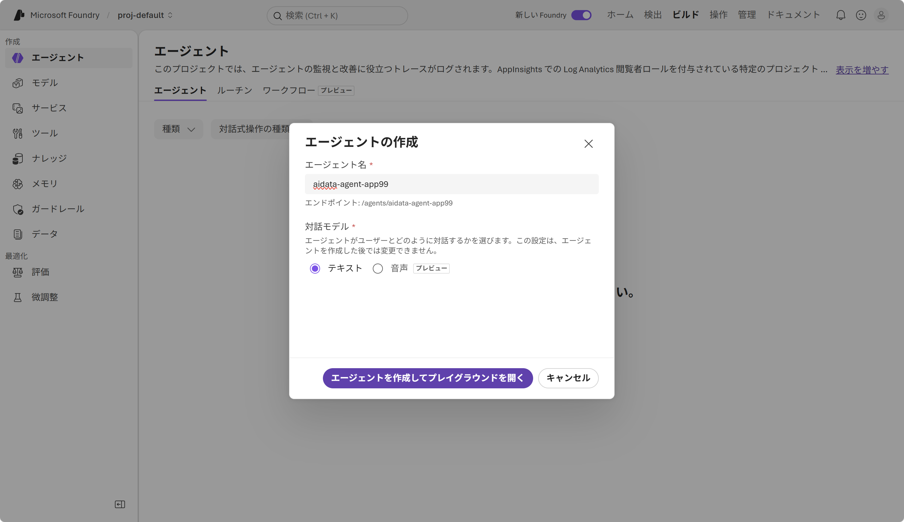
2. モデルに IQ と同じ `gpt-5.6-luna` デプロイを選択する。Agent の **Knowledge** またはツール追加画面から `aidata-kb-＜No＞` に接続する。
   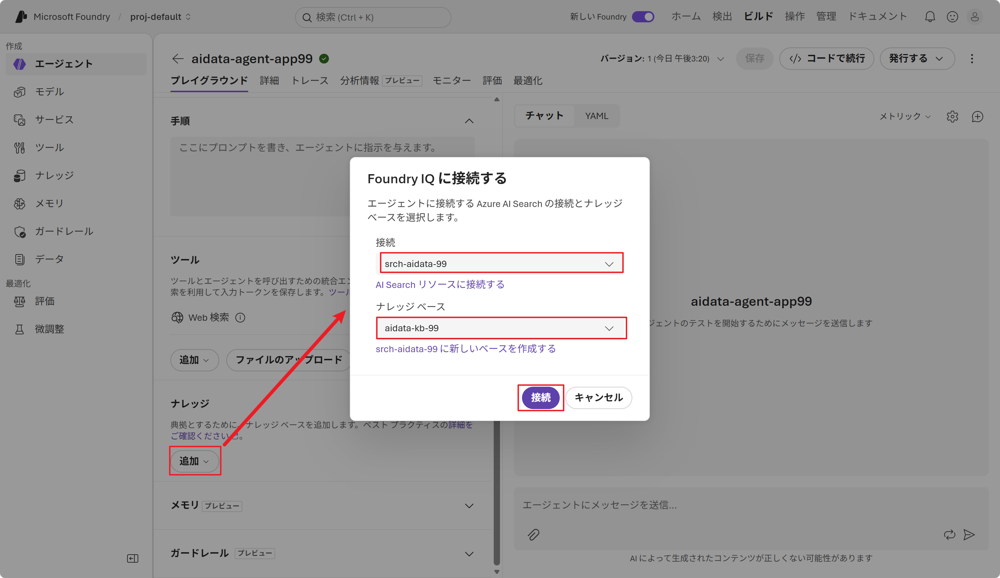
3. Web 検索ツールを削除する。
   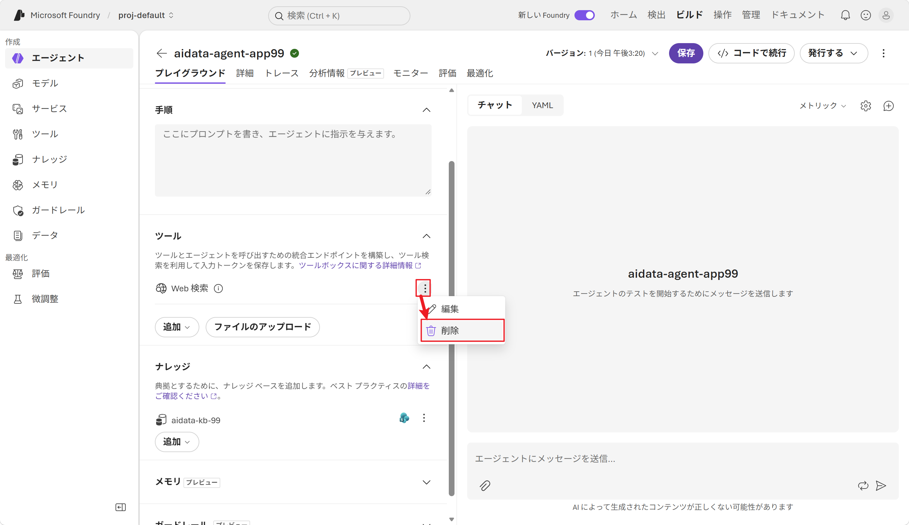

## SharePoint のサイト権限切り替えを検証する

### 共通条件と Prompt A

- **すべて参加者、同じ Prompt A** を使用する。
- 各回、新しい会話を開始する。メモリ ストアは接続しない。
- IQ のナレッジ ソースは SharePoint Remote のみとし、文書を File Search などに複製しない。
- 応答本文だけでなく、IQ の呼び出し記録、SharePoint の参照 URL、取得内容を確認する。ログは運営指定のトレース／取得ログで確認し、トークンは記録しない。
- 検証中は Agent の指示やモデル、検索範囲を変更しない。

Prompt A

```text
SharePointの文書「営業改善施策ガイド」
（文書ID：HOL-SP-RAG-2016-01）を検索してください。

次の情報を、文書に記載された内容に基づいて回答してください。
1. 営業改善レビューの対象となるProfitの前年比減少率
2. 上長への報告期限
3. 文書の版
4. 確認コード

参照した文書のリンクと、根拠となる短い引用も示してください。
アクセス可能な資料で確認できない項目は、推測せず、その旨を明記してください。
```

### テスト A：サイト 1 の V1 から 8% を取得する

1. ユーザー  でサイト 1 の V1 を直接開け、サイト 2 の V2 は開けないことを再確認する。
2. 新しい会話で Prompt A を入力する。
3. 次の **結果 A** と照合する。

   | 項目                 | 結果 A                               |
   | -------------------- | ------------------------------------ |
   | レビュー対象の減少率 | 前年の Profit が正の値で、8%以上減少 |
   | 報告期限             | 2営業日以内                          |
   | 版                   | 1.0                                  |
   | 確認コード           | SP-A731                              |
   | 参照元               | サイト 1 の営業改善施策ガイド        |

   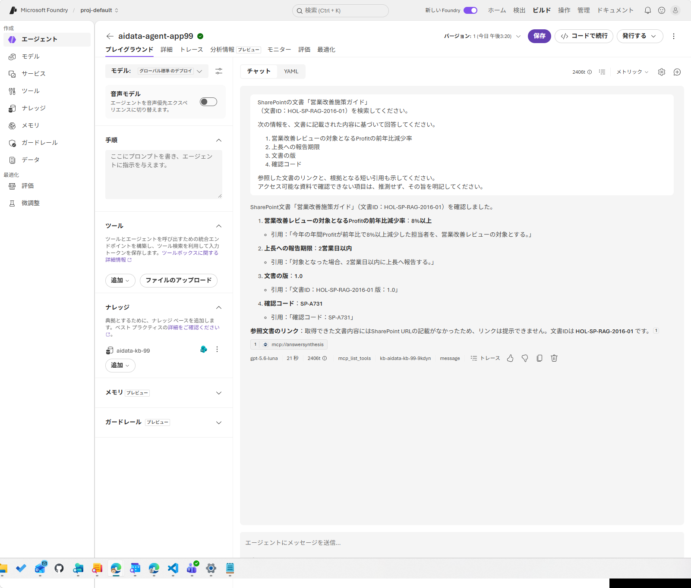
4. 応答メッセージの下部にある **トレース** ボタンをクリックし、knowledge_base_retrieve の呼び出し内容と取得結果を確認する。
   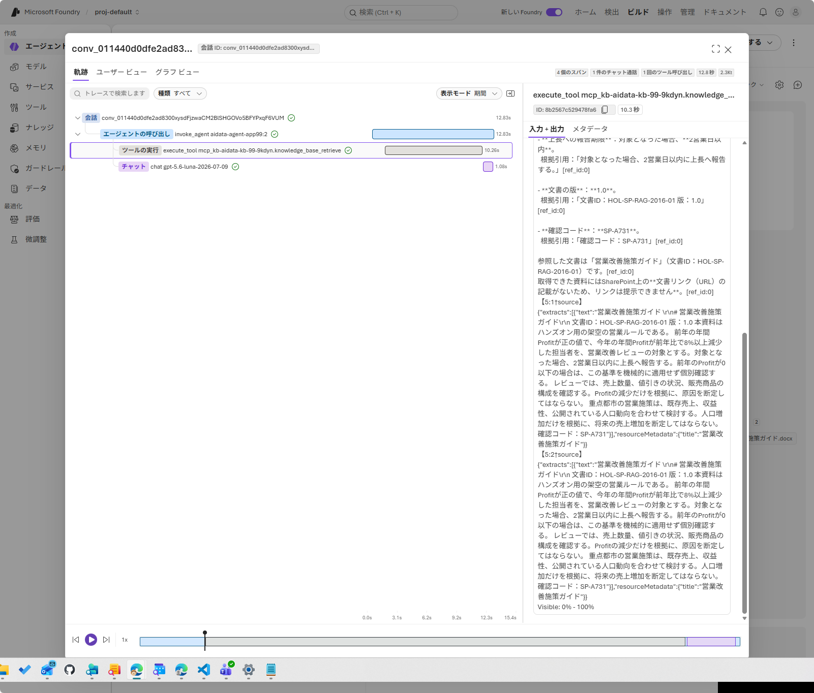

### テスト B：サイト 1 からサイト 2 へ権限を切り替え、12% を取得する

講師が admin アカウントで、ユーザー A の **サイト 1 の読み取り権限を削除**し、ユーザー A に **サイト 2 の読み取り権限を付与**する。

1. ユーザー のブラウザーで新しくアクセスし、サイト 1 の V1 はアクセス拒否、サイト 2 の V2 は直接開けることを確認する。
2. 新しい会話で、 Prompt A を入力する。
3. 次の **結果 B** と照合する。

   | 項目                 | 結果 B                                |
   | -------------------- | ------------------------------------- |
   | レビュー対象の減少率 | 前年の Profit が正の値で、12%以上減少 |
   | 報告期限             | 1営業日以内                           |
   | 版                   | 2.0                                   |
   | 確認コード           | SP-B946                               |
   | 参照元               | サイト 2 の営業改善施策ガイド         |

   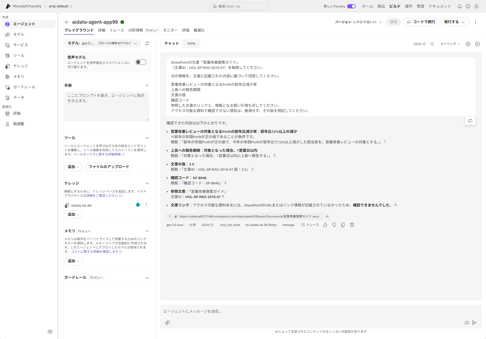
4. 応答メッセージの下部にある **トレース** ボタンをクリックし、knowledge_base_retrieve の呼び出し内容と取得結果を確認する。
   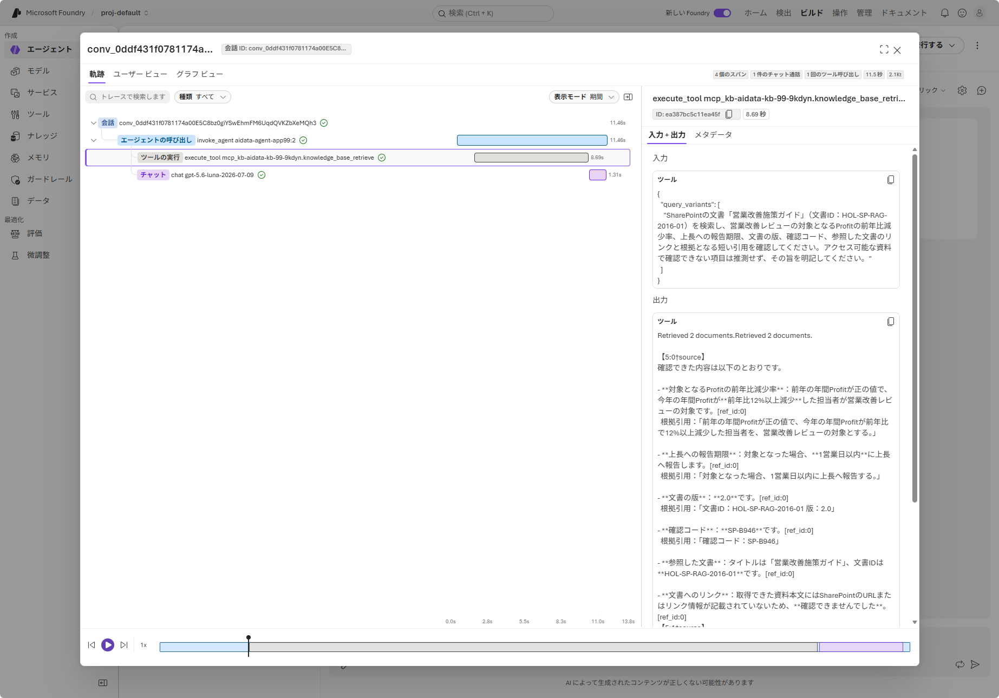

> この実験で示すのは、SharePoint Remote が検索時のユーザー権限に従って、アクセス可能なサイトの文書を取得することである。権限変更には反映待ちが発生し得る。旧値が返る場合は、新規会話で 30 秒以上の間隔を空けて最大 5 回確認する。

## Fabric Ontology を IQ に追加する

### Ontology のナレッジ ソース

1. Foundry の **ビルド / Build** → **ナレッジ / Knowledge** で、作成したナレッジ ベース `aidata-kb-＜No＞` を開く。
2. **ソースの追加** をクリックし、**Fabric IQ** を選択する。
   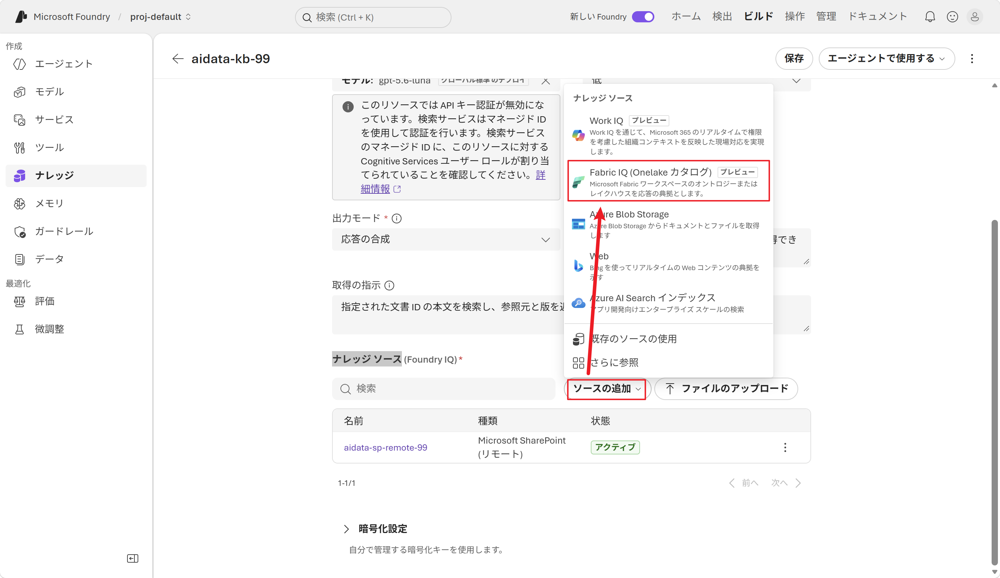
3. Day1 で作成されたOntology (eg: `aidataontology＜No＞`) を選択する。
4. 名前に`aidata-ontology-＜No＞` を入力し、**作成**を選択する。
   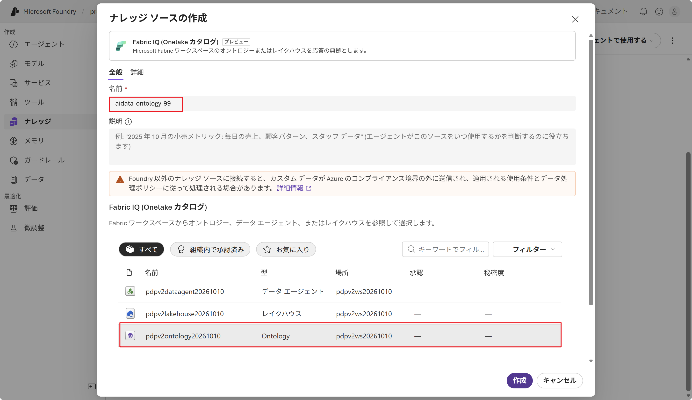
5. ナレッジ ソース一覧に **SharePoint Remote + Ontology** があることを確認し、**保存**を選択する。
   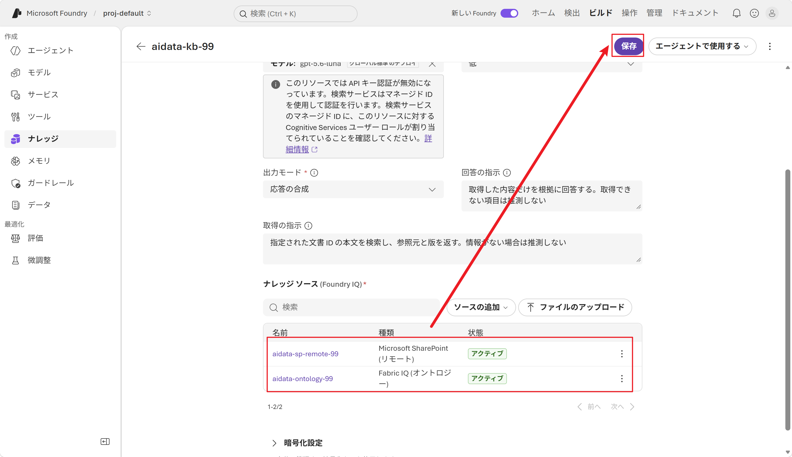

## Fabric と SharePoint の統合回答を確認する

1. SharePoint テストで作成した Agent `aidata-agent-app＜No＞` を開き、設定内容を確認する。
2. ナレッジ ベース `aidata-kb-＜No＞` の参照一覧が **SharePoint Remote + Ontology** である。
3. 新しい会話で次を入力する、結果を確認する。

```text
IQのFabric Ontologyナレッジ ソースを使い、2014年と2015年のEmployee別Profit合計を比較し、
前年差と前年比増減率を示してください。
前年比増減率は、前年Profitが正の値の場合だけ
（当年Profit－前年Profit）÷前年Profit×100で計算し、
前年Profitが0以下の場合は個別確認としてください。

SharePointの「営業改善施策ガイド」（文書ID：HOL-SP-RAG-2016-01）を参照し、
レビュー対象となるEmployee、確認すべき項目、上長への報告期限を示してください。
該当者がいなければ、その旨を明記してください。

数値の対象期間と集計列、参照したガイドのリンク・版を示してください。
ガイドを取得できない場合は数値比較のみを行い、
社内基準による判定はできないと明記してください。
```

   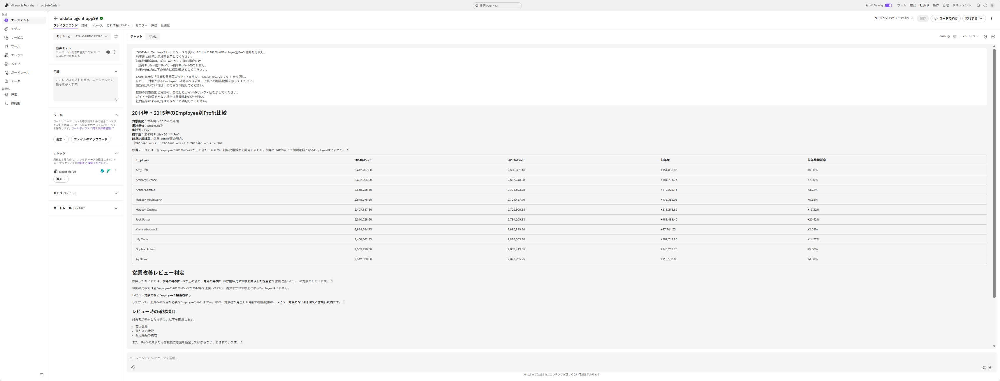
4. 応答メッセージの下部にある **トレース** ボタンをクリックし、knowledge_base_retrieve の呼び出し内容と取得結果を確認する。
   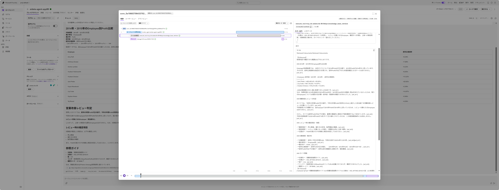

確認するポイント:

- Agent の IQ 呼び出しに加え、IQ の取得ログに **Fabric Ontology と SharePoint Remote の両ナレッジ ソース**が記録されている。
  -- 2014 年と 2015 年の Profit が Fabric の値と一致している。
- 前年比の減少率が 12%以上の場合、増減率では `-12%` 以下が該当する。
- 判断基準は V2 の **12%以上**、報告期限は **1営業日以内**である。
- 確認項目は取得したガイドに基づく。データにない値引きの実態や減益原因を断定しない。
- 取得できた事実と、今後の調査・提案が区別されている。

## IQ に Web 検索を追加する

### Web Knowledge Source の追加

1. Foundry の **ビルド / Build** → **ナレッジ / Knowledge** で、作成したナレッジ ベース `aidata-kb-＜No＞` を開く。
2. **ソースの追加** をクリックし、**Web** を選択する。
   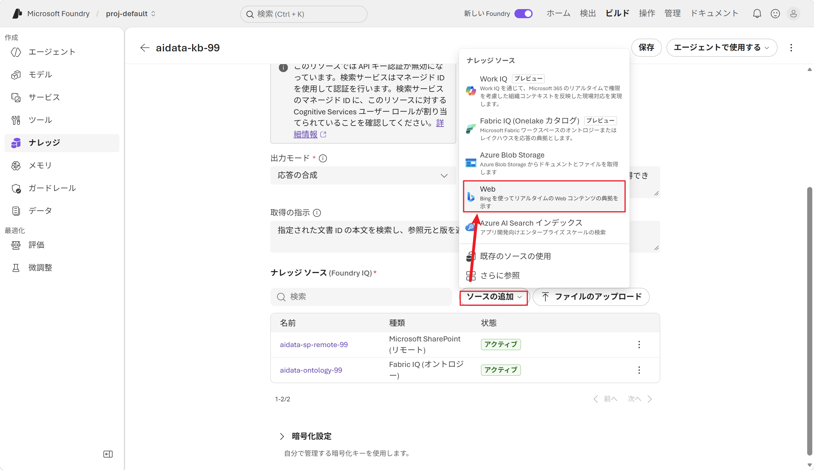
3. 名前に `aidata-web-＜No＞` を入力し、**作成**を選択する。
   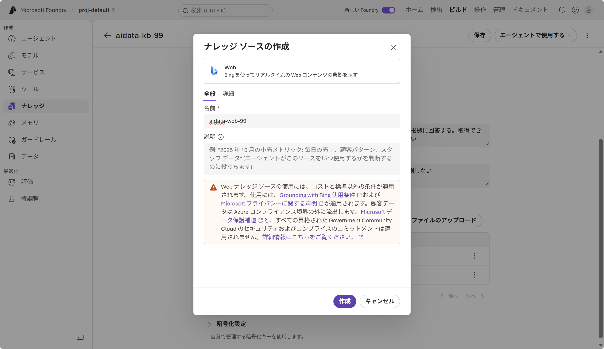
4. ナレッジ ソース一覧に **SharePoint Remote + Ontology + Web** があることを確認し、**保存**を選択する。
   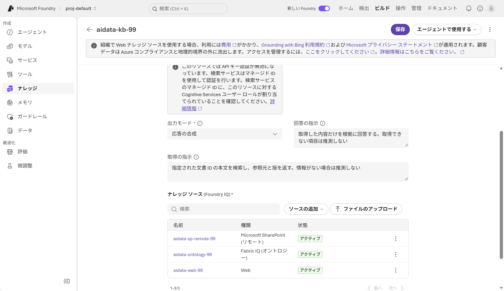

### Fabric、SharePoint、Web の統合テスト

1. SharePoint テストで作成した Agent `aidata-agent-app＜No＞` を開き、設定内容を確認する。
2. ナレッジ ベース `aidata-kb-＜No＞` の参照一覧が **SharePoint Remote + Ontology + Web** である。
3. 新しい会話で次を入力する、結果を確認する。

```text
IQのFabric Ontologyナレッジ ソースを使い、
データに含まれる2016年の売上をTotalExcludingTaxの合計でCity別に集計し、
最も売上が大きい都市を特定してください。実際のデータ対象期間も示してください。

その都市を州・国まで特定したうえで、公開情報から人口増減の傾向を調べ、
出典と人口統計の対象時点を示してください。
2016年の売上と人口統計の対象時点が異なる場合は、その違いを明記してください。

さらに、SharePointの「営業改善施策ガイド」
（文書ID：HOL-SP-RAG-2016-01）の重点都市の方針を参照し、
営業施策を検討する際の確認事項を提案してください。
売上の事実、公開情報、社内方針、提案を区別し、それぞれの根拠を示してください。
```

   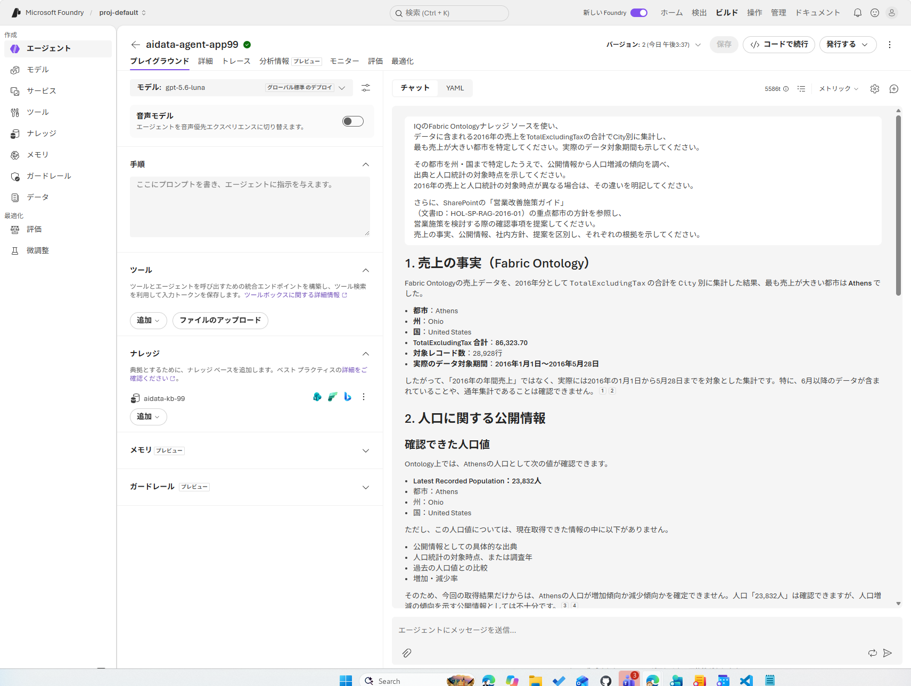

## Teams に公開して動作確認する

### 公開操作

1. Agent `aidata-agent-app＜No＞` で、テストしたバージョンを **Active version** に選択する。
2. **発行する** → **Teams と Microsoft Copilot** を選択する。
   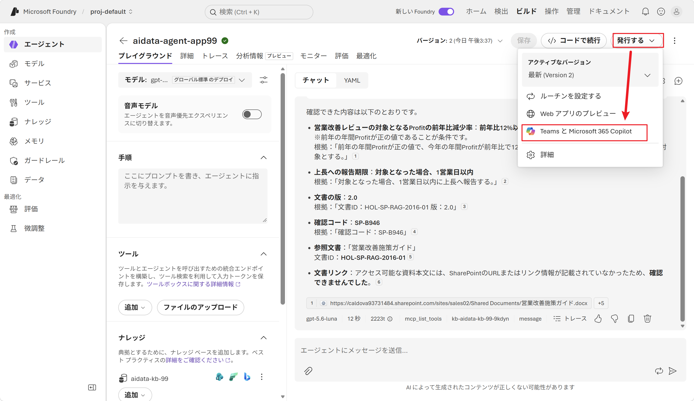
3. 表示名を `aidata-agent-app＜No＞` とし、説明 (`aidata ハンズオンで作成した　Foundry Agent`)、開発者情報、発行バージョンなどの必須項目を入力する。

   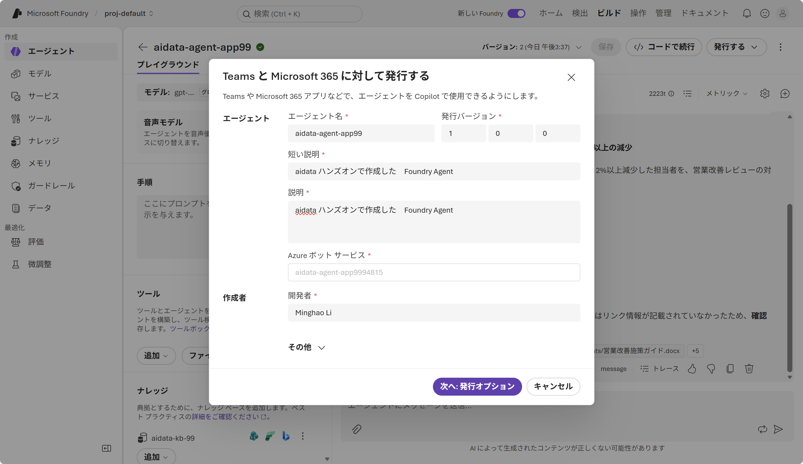
4. **次へ:発行オプション** を選択する。直接発行にて、**自分のみ**を選択する。

   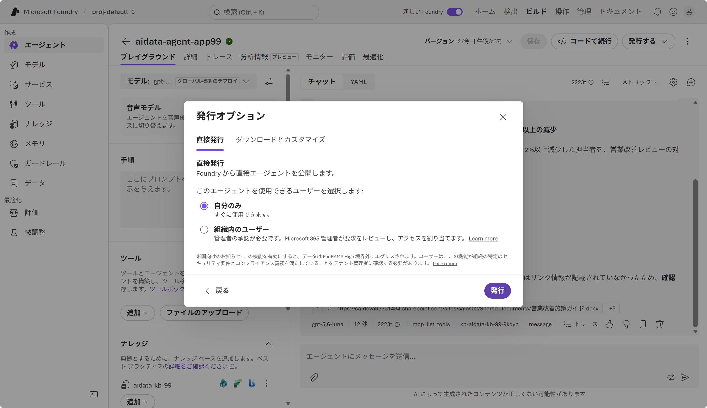
5. **発行** を選択し、Agent を公開する。
6. 発行完了したら、Popup画面に表示された**Microsoft 365 Copilot エージェント ストア**リンクをクリックし、公開した Agent を確認する。
   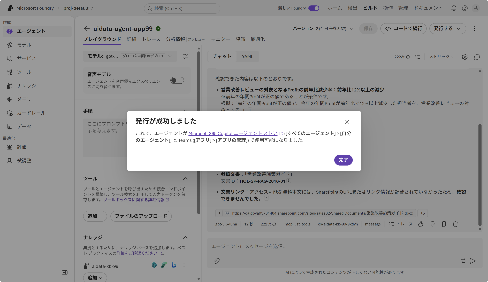
7. 公開されたAgentを選択し、まず IQ 経由で Ontology の基礎質問を実行する。

   ```text
   IQのFabric Ontologyナレッジ ソースを使い、2014年と2015年でEmployeeごとのProfit合計を比較してください。
   ```

   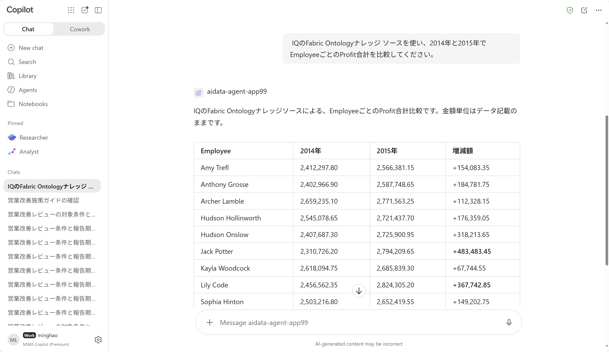
8. Prompt A と、公開 Web 情報の質問も新しい会話で試す。運営が指定した新規会話の開始方法を使い、履歴を引き継がない。

## トラブルシューティング

### 問題の切り分け

| 症状                                               | 確認すること                                                                                                        |
| -------------------------------------------------- | ------------------------------------------------------------------------------------------------------------------- |
| IQ のナレッジ ソースやモデルを選択できない         | 新しい Foundry のプロジェクト形式、対応リージョン、モデル、ポータルの対応状況                                       |
| gpt-5.6-luna を IQ で使用できない                  | `2026-08-01-preview` 対応状況、同じデプロイを選択しているか、モデル接続の権限。別モデルを無断で追加しない         |
| デプロイ時にクォータ不足となる                     | 80,000 TPM の手動設定、同じサブスクリプション・リージョン・モデル・デプロイ種類の残量、既存割り当てと参加者分の合計 |
| モデル呼び出しが 429 になる                        | Agent と IQ が同じ TPM／RPM を共有していること、実際の呼び出し回数、同時実行、指定された再試行待機時間              |
| Ontology が一覧にない                              | Fabric のテナント設定、利用者の権限、workspace、項目 ID、旧／新エクスペリエンスの互換性                             |
| Ontology の問い合わせが失敗する                    | `minimal` を選んでいないか、Search 向け利用者トークンと OBO、サービス間 RBAC                                      |
| Ontology の集計が不一致                            | 数値・日付の型、請求日の期間、データバインディング、識別キー、関係による二重計上                                    |
| SharePoint テストで数値が返る                      | 既存のナレッジ ソースや独立ツールが接続されていないか、過去の会話・メモリを使っていないか                           |
| IQ またはモデルの呼び出しが 401 / 403 になる       | サービス間 RBAC、接続先、モデル権限と、ユーザー ID 透過を別々に確認                                                 |
| 権限があるのに SharePoint の結果がない             | ライセンス／従量課金、委任ユーザー、フォルダーの KQL、文書の発行状態、検索側の反映                                  |
| 編集したナレッジ ベースと Agent の結果が一致しない | ナレッジ ベースの実名と MCP URL 内の名前が一致するか。新しいナレッジ ベースを作った後も古い接続を使用していないか   |
| サイト 1 の 8% が切り替え後も返る                  | サイト 1 の別経路の権限、サイト 2 の権限付与、実際の呼び出しユーザー、新規会話、固定トークン、伝播待ち              |
| サイト 2 の V2 を取得できない                      | サイト 2 の直接アクセス、グループ・共有リンク、実際の呼び出しユーザー、検索範囲、文書の発行状態、伝播待ち           |
| Web を追加したが回答に出典がない                   | ナレッジ ベースのモデル接続、Web 利用可否、許可ドメイン、実際の Web ナレッジ ソースの呼び出し                       |

終了後は、運営の指示に従って実験文書の共有設定を戻し、ラボ専用の公開 Agent、ナレッジ ベース、Search、モデル等の継続利用要否を確認する。共有リソースや Day1 のリソースを無断で削除しない。

## 参考資料

- [Foundry IQ の概要とポータルでの構成](https://learn.microsoft.com/azure/foundry/agents/concepts/what-is-foundry-iq)
- [IQ の対応モデルと API バージョン](https://learn.microsoft.com/azure/search/agentic-retrieval-how-to-create-knowledge-base#supported-models)
- [モデルの TPM 割り当てとサブスクリプションのクォータ](https://learn.microsoft.com/azure/foundry/openai/how-to/quota#introduction-to-quota)
- [Fabric Ontology ナレッジ ソース、推論設定、OBO、取得根拠](https://learn.microsoft.com/azure/search/agentic-knowledge-source-how-to-fabric-ontology)
- [Ontology を使う Foundry IQ Agent の作成](https://learn.microsoft.com/fabric/iq/ontology/how-to-create-agent-foundry-iq)
- [Ontology のテナント設定](https://learn.microsoft.com/fabric/iq/ontology/overview-tenant-settings)
- [代替用 Fabric Data Agent ナレッジ ソース](https://learn.microsoft.com/azure/search/agentic-knowledge-source-how-to-fabric-data-agent)
- [SharePoint Remote ナレッジ ソース、フィルター、ユーザー権限](https://learn.microsoft.com/azure/search/agentic-knowledge-source-how-to-sharepoint-remote)
- [IQ ナレッジ ベースと Foundry Agent の接続、リクエストごとのユーザー ID](https://learn.microsoft.com/azure/foundry/agents/how-to/foundry-iq-connect)
- [Azure portal でのナレッジ ソース・ナレッジ ベースの作成](https://learn.microsoft.com/azure/search/get-started-portal-agentic-retrieval)
- [Web Knowledge Source の設定、制限、データ処理条件](https://learn.microsoft.com/azure/search/agentic-knowledge-source-how-to-web)
- [Microsoft 365 Copilot Retrieval API](https://learn.microsoft.com/microsoft-365/copilot/extensibility/api/ai-services/retrieval/overview)
- [Teams と Microsoft 365 への公開](https://learn.microsoft.com/azure/foundry/agents/how-to/publish-copilot)

以上、お疲れさまでした。
